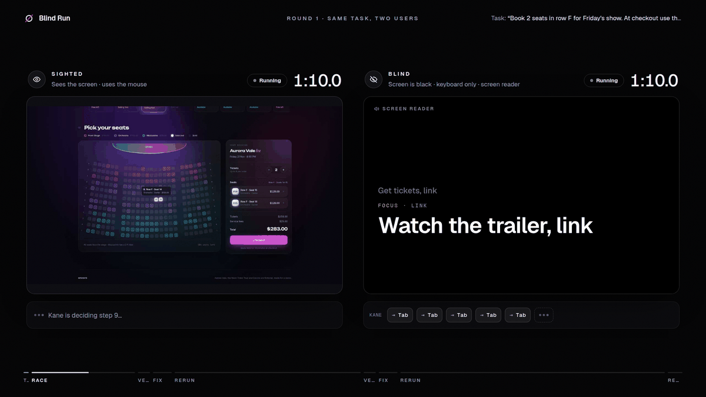
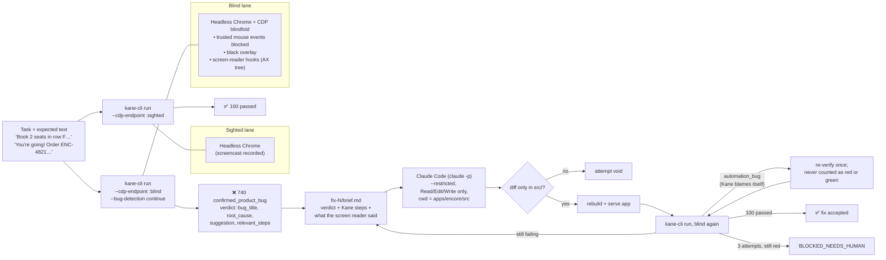
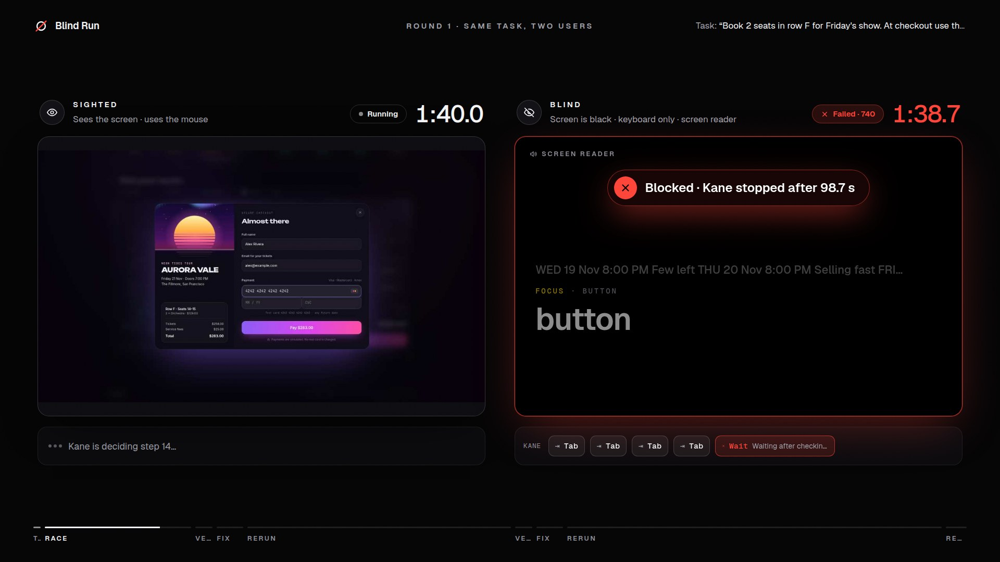
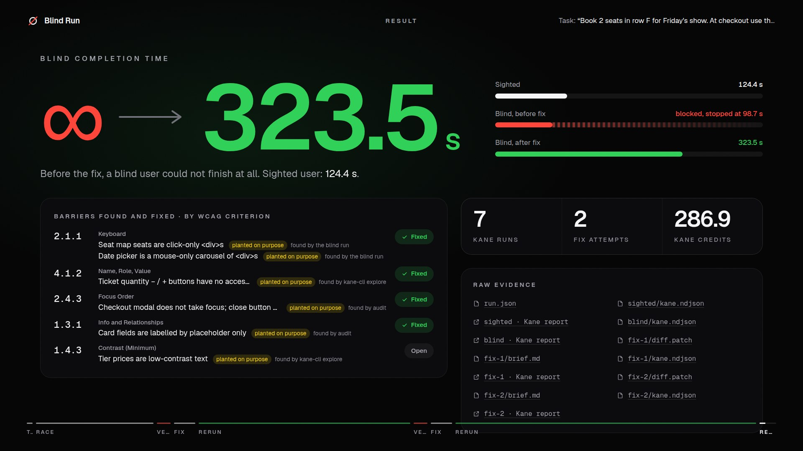
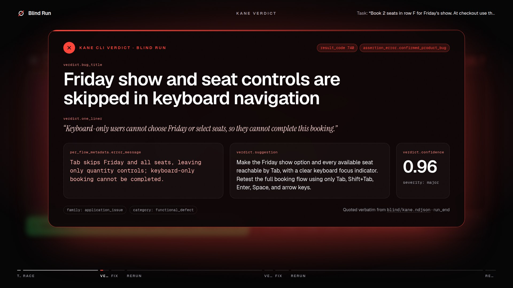

# Blind Run

**Your app works when you can see it. Does it work with your eyes closed?**

Blind Run gives [Kane CLI](https://www.lambdatest.com/kane-cli) the same task twice: once as a sighted user, and once as a blind user. In the blind run the screen is black, the mouse doesn't work and a screen reader speaks every focus change. When the blind run fails, Kane's verdict goes to a coding agent (Claude Code), which fixes the app. The fix only counts once Kane, still blindfolded, completes the task.

[](https://github.com/aldridge-fonseca/blind-run/actions/workflows/ci.yml)




<sub>The Theater replaying the committed run <code>runs/encore-2026-11-18</code>. Every red and green here comes from a real Kane CLI run, and the NDJSON is committed byte for byte.</sub>

| | Sighted | Blind, before the fix | Blind, after Claude Code's fix |
|---|---|---|---|
| Kane result | ✅ `100 success.complete` | ❌ `740 assertion_error.confirmed_product_bug` | ✅ `100 success.complete` |
| Time to book 2 seats | 124.4 s | **∞**: Kane stopped at 98.7 s, blocked | 323.5 s |
| Kane steps | 18 | 11 | 48 |

7 Kane runs, 286.9 Kane credits, 2 fix attempts by Claude Code, and 5 of 6 planted barriers fixed. The low-contrast prices are honestly left **open**.

---

## Judge it in 90 seconds

You need Node 24+ and pnpm. No keys, no Kane account and no network after install.

```sh
git clone https://github.com/aldridge-fonseca/blind-run && cd blind-run
pnpm install
pnpm demo        # builds the Theater with the committed runs → http://localhost:4320/?run=latest
```

**What you'll see:** the sighted lane books the seats, while the blind lane Tabs past the date picker and seat map and goes **red with Kane's 740 verdict**, quoted verbatim. Next comes Claude Code's real diff, then the blind rerun going **green** on *"You're going! Order #ENC-4821 · Row F · Seats 14–15"*. Press `?` for shortcuts, `R` to reveal the page under the blindfold, or add `&present=1` for the 1920×1080 show.

**Check that the evidence is real:** `pnpm test` runs the package tests plus [`tests/runs.test.mjs`](tests/runs.test.mjs). That test re-reads every committed `kane.ndjson` and fails if any summary disagrees with Kane's own `run_end`: result code, status, or the verdict object, which must match field for field. It also checks that every agent diff touches only `apps/encore/src/`.

| Evidence | Path |
|---|---|
| Run manifest (sequence, credits, barriers) | [`runs/encore-2026-11-18/run.json`](runs/encore-2026-11-18/run.json) |
| Sighted lane, Kane NDJSON | [`sighted/kane.ndjson`](runs/encore-2026-11-18/sighted/kane.ndjson) |
| Blind lane, **the 740** | [`blind/kane.ndjson`](runs/encore-2026-11-18/blind/kane.ndjson) (line 28 is `run_end`) |
| What the screen reader said | [`blind/announcements.jsonl`](runs/encore-2026-11-18/blind/announcements.jsonl) |
| Fix briefs given to Claude Code | [`fix-1/brief.md`](runs/encore-2026-11-18/fix-1/brief.md), [`fix-2/brief.md`](runs/encore-2026-11-18/fix-2/brief.md) |
| Claude Code's diffs and logs | [`fix-1/diff.patch`](runs/encore-2026-11-18/fix-1/diff.patch), [`fix-2/diff.patch`](runs/encore-2026-11-18/fix-2/diff.patch), `fix-N/agent.log` |
| Blind re-verification, **green** | [`fix-2/kane.ndjson`](runs/encore-2026-11-18/fix-2/kane.ndjson) |
| `kane-cli explore` (axe-core) | [`explore/`](runs/encore-2026-11-18/explore/) |
| `--analyzer-only` condition probes | [`analyzer/summary.json`](runs/encore-2026-11-18/analyzer/summary.json) |
| Kane Test Manager reports | `testUrl` in each `lane.json` |

Want to spend real credits? `pnpm live` reruns the whole thing (see [Run it live](#run-it-live)).

---

## How it works



1. **Two lanes, one task.** Each lane gets its own headless Chrome. Kane attaches with `--cdp-endpoint`, so Blind Run controls the browser Kane is driving.
2. **The blindfold is enforced in the browser, not in the prompt.** Before any page script runs, Blind Run injects a script over CDP (`Page.addScriptToEvaluateOnNewDocument`) on every page, including the ones Kane opens. That script blocks trusted pointer and mouse events but lets keyboard-generated clicks (`detail === 0`) through, and it paints a black overlay, so Kane's own screenshots really are black. If Kane tries to "cheat" with the mouse, nothing happens.
3. **A screen reader you can hear.** On every `focusin` and live-region change, Blind Run reads the node from Chrome's accessibility tree (`Accessibility.getPartialAXTree`) and writes an NVDA-style line such as `Seat F14, button, not pressed`. An icon-only button is announced as just "button". ElevenLabs voices the lines for the Theater.
4. **Kane judges.** With `--bug-detection continue`, Kane separates *the app is broken* (`740`, `family: application_issue`, `confirmed: true`) from *I got stuck* (`family: automation_bug`).
5. **The agent fixes; Kane decides.** Claude Code gets the brief and edits the app source. Blind Run rebuilds the app and Kane reruns the blind lane. That run's `run_end` is the only thing that closes the loop.



### What happened in the committed run

| Step | What happened | Kane result |
|---|---|---|
| Sighted | Booked F14–F15, checked out, confirmed | `100` · 124.4 s · 31.6 cr |
| Blind | Tabbed page → header links → hero links → *"WED 19 Nov … , clickable"* (the date strip, not focusable) → "button" → nothing else to reach | **`740`** · confidence 0.96 · 31.4 cr |
| Fix 1 | Claude Code (46 turns, $1.12) turned dates into a radio group and the seat map into an ARIA grid, and labelled the stepper, modal and card fields. 7 files changed | `310 stuck.max_steps`, `automation_bug`, `confirmed: false`. Kane blamed its own run, so it was re-verified once: `310` again. **Not counted** either way |
| Fix 2 | Brief from that run. Claude Code (26 turns, $0.73) found that picking a 2nd seat silently replaced the 1st, and that "Remove seat" was easy to mistake for Checkout. It fixed seat-picking, focus after removal, and reachable-but-unavailable Checkout, and added a skip link. 3 files changed | ✅ **`100 success.complete`** · 48 steps · 323.5 s |

The agent never touched the task, the expected text, the tests or Blind Run itself. It ran with `--restricted` and only the Read/Edit/Write/Glob/Grep tools, with its working directory set to `apps/encore/src`, and any change outside `src/` voids the attempt.



---

## Kane's three roles

1. **Product runtime: Kane *is* the users.** The same Kane agent plays a sighted mouse user and a blind keyboard-and-screen-reader user, on any URL you give it.
2. **Verifier: Kane gives the verdict.** The red is Kane's `740 assertion_error.confirmed_product_bug` with a root cause and a suggestion. The green is Kane completing the task blind and reading the confirmation text.
3. **Gate in the build loop: Kane decides whether a fix counts.** The coding agent's work is accepted only when Kane's blind rerun returns `100`. Kane's self-blame verdicts (`automation_bug`) are re-verified, never counted as a pass or a product failure.

---

## Niche Kane CLI features used (exact commands)

**1. `--cdp-endpoint`: Kane drives a browser we constrained.** This is what makes the blindfold real: Kane runs inside a Chrome where the mouse is dead and the screen is black.

```sh
kane-cli run "<blind objective>" --url http://127.0.0.1:4310/ \
  --cdp-endpoint http://127.0.0.1:<port> --agent \
  --bug-detection continue --assertion-mode dom --max-steps <n> --timeout 900
```

The blind objective, verbatim from [`blind/lane.json`](runs/encore-2026-11-18/blind/lane.json):

> You are a blind user who navigates with the keyboard only (Tab, Shift+Tab, Enter, Space, arrow keys).
> The mouse does not work and the screen is black.
> Book 2 seats in row F for Friday's show. … Verify, by reading the page text as a screen reader would, that the page says "You're going! Order #ENC-4821 · Row F · Seats 14–15".

**2. `--bug-detection continue`: 740 verdicts.** Kane's `run_end` carries a structured verdict (`family`, `confirmed`, `bug_title`, `root_cause`, `agent_fault_assessment`, `suggestion`, `relevant_steps`). Blind Run feeds it to the agent as-is and uses `family`/`confirmed` to tell a product bug from a Kane misstep.

**3. `kane-cli explore`: axe-core findings we didn't script.** It runs local, read-only and capped at 3 leases. It cost 15.9 credits on the baseline:

```sh
kane-cli explore run --url http://127.0.0.1:4310/ \
  --prompt "Explore the booking flow with the keyboard and note accessibility problems" \
  --max-leases 3 --local-orchestration --browser local --headless \
  --policy read_only --no-recheck --agent --project <project-id>
```

From [`explore/findings.json`](runs/encore-2026-11-18/explore/findings.json): `button-name` (high, 2 elements: the icon-only ± stepper, **B2**), `color-contrast` (medium, 14 elements: includes the tier prices, **B6**) and `scrollable-region-focusable` (medium, 1 element: the date strip, **B3**).

**4. `--analyzer-only --condition`: yes/no probes on a page, with no actions.** We judged the same five conditions on the baseline and on the fixed build:

```sh
kane-cli run --analyzer-only --cdp-endpoint http://127.0.0.1:9333 --agent --assertion-mode dom \
  --condition "The date options under 'Choose your night' are keyboard-focusable controls …" \
  --condition "The ticket quantity minus and plus buttons each have an accessible name …" \
  --condition "The tier prices in the seat legend have a text contrast ratio of at least 4.5:1 …" \
  --condition "…"   # full text in analyzer/summary.json
```

| Condition (abridged) | Baseline | After Claude Code's fix |
|---|---|---|
| Date options are keyboard-focusable (B3) | ❌ false | ✅ true |
| Quantity −/+ have accessible names (B2) | ❌ false | ✅ true |
| Tier prices meet 4.5:1 contrast (B6) | ❌ false | ❌ false (not fixed, matches the run) |
| Every seat is focusable and named | ❌ false | ❌ false, see below |
| Seat map is Tab-reachable (roving tabindex counts) | ❌ false | ❌ false, see below |

The seat-map conditions stay false on the fixed build, and that's correct for the page Kane looked at. The fixed seat map is an ARIA grid with a roving tabindex, which stays **locked (every seat `tabindex=-1`) until a night is chosen**. On the initial page no seat is a Tab stop yet. That's why this static probe complements a full blind run but can't replace one. Note: `--analyzer-only` ignores `--url` and judges the current page, so each probe ran in a Chrome opened directly on that build (the only tab, checked before and after).

---

## The verdict, verbatim

From [`runs/encore-2026-11-18/blind/kane.ndjson`](runs/encore-2026-11-18/blind/kane.ndjson), line 28. These are the `run_end` fields, pretty-printed with the values untouched:

```json
{
  "type": "run_end",
  "status": "failed",
  "result_code": 740,
  "reason_code": "assertion_error.confirmed_product_bug",
  "reason": "Tab skips Friday and all seats, leaving only quantity controls; keyboard-only booking cannot be completed.",
  "one_liner": "Keyboard-only users cannot choose Friday or select seats, so they cannot complete this booking.",
  "verdict": {
    "confirmed": true,
    "status": "failed",
    "family": "application_issue",
    "category": "functional_defect",
    "category_proposal": "",
    "severity": "major",
    "root_cause": "The booking controls for the Friday show and individual seats are not reachable when moving through the page with the Tab key. The keyboard reaches only the quantity controls.",
    "agent_fault_assessment": "The agent followed the required keyboard-only method and used Tab to move through the page. It did not click, type into an unrelated field, or make a wrong selection. The required Friday and seat controls were skipped by the page's keyboard focus order, so the agent could not cause or recover from this outcome.",
    "bug_title": "Friday show and seat controls are skipped in keyboard navigation",
    "signals": [
      {
        "step": "0-10",
        "kind": "objective_contradiction",
        "excerpt": "Tab skips Friday and all seats, leaving only quantity controls; keyboard-only booking cannot be completed."
      }
    ],
    "confidence": 0.96,
    "suggestion": "Make the Friday show option and every available seat reachable by Tab, with a clear keyboard focus indicator. Retest the full booking flow using only Tab, Shift+Tab, Enter, Space, and arrow keys.",
    "one_liner": "Keyboard-only users cannot choose Friday or select seats, so they cannot complete this booking.",
    "relevant_steps": [2, 3, 4, 10],
    "culprit_step": "0-10",
    "credits_consumed": 4.295,
    "mode": "terminal"
  },
  "credits_consumed": 31.399869999999996
}
```

And the green, from [`fix-2/kane.ndjson`](runs/encore-2026-11-18/fix-2/kane.ndjson):

```json
{
  "type": "run_end",
  "status": "passed",
  "result_code": 100,
  "reason_code": "success.complete",
  "summary": "Booked two seats in Row F for Friday's show.\nCompleted checkout using the provided contact and test payment details.\nThe booking was confirmed: You're going! Order #ENC-4821 · Row F · Seats 14–15.",
  "one_liner": "booked two Row F seats for Friday's show on the event booking site",
  "credits_consumed": 64.1840805
}
```



---

## The planted barriers

> **These are intentionally planted.** Encore (`apps/encore`) is a fictional concert-booking app built to be tested. It works perfectly with a mouse and is broken on purpose for a blind keyboard user, in six common, real-code ways: no feature flags and no `?fixed=1` toggles. The broken baseline is the git tag `encore-baseline`. Details and line links are in [`apps/encore/BARRIERS.md`](apps/encore/BARRIERS.md).

| ID | WCAG 2.2 | Planted barrier | Found by | Fixed by Claude Code? |
|---|---|---|---|---|
| B1 | 2.1.1 Keyboard | Seat map seats are click-only `<div>`s | Kane blind run (740) | ✅ ARIA grid, arrow keys |
| B2 | 4.1.2 Name, Role, Value | Ticket −/+ buttons have no accessible name | `kane-cli explore` (axe `button-name`) | ✅ "Add a ticket" / "Remove a ticket" |
| B3 | 2.1.1 Keyboard | Date picker is a mouse-only carousel of `<div>`s | Kane blind run (740) | ✅ radio group, one Tab stop |
| B4 | 2.4.3 Focus Order | Checkout modal doesn't take focus; close button unlabeled | Blind Run audit (AX tree) | ✅ `role=dialog`, focus trap, Escape |
| B5 | 1.3.1 / 3.3.2 | Card fields labelled by placeholder only | Blind Run audit (AX tree) | ✅ real labels |
| B6 | 1.4.3 Contrast | Tier prices are low-contrast text | `kane-cli explore` (axe `color-contrast`) | ❌ **open**. Not a blind-user blocker, and the agent was told to leave the visual design alone |

The before/after audit (`audit/before.json`, `audit/after.json`) reads Chrome's accessibility tree through stable `data-testid`s. That's how `run.json` knows which barriers were really removed, rather than trusting the agent's summary.

---

## What Kane can't check here

Honest limits of this demo and of the tool:

- **This is a simulated blind user, not a real one.** The blindfold makes the mouse useless and the screen black, and Kane drives the keyboard. That proves the flow is *operable* without sight. It doesn't prove the experience is *good* for a real NVDA, JAWS or VoiceOver user.
- **The screen-reader voice is NVDA-*style*, not NVDA.** Announcements are built from Chrome's accessibility tree (role, name, states). Real screen readers differ in verbosity and in how they handle virtual cursors and browse mode.
- **Kane doesn't hear the audio.** It reads the DOM and screenshots. The ElevenLabs voice is for humans watching the Theater.
- **Kane can blame itself.** Fix 1's rerun ended `310 stuck.max_steps` with `automation_bug, confirmed: false`. Blind Run treats that as *not checked*: it never counts as product-red or green, and it costs a re-verification (99 extra credits in this run).
- **Contrast (B6) isn't a blind-run concern.** It was found by `explore`/axe-core and left open, so the end card says *Open*, not *Fixed*.
- **Static probes miss stateful widgets.** The `--analyzer-only` seat-map condition stays false on the fixed build because the grid is locked until a night is chosen (see above).
- **`explore` stopped on budget.** We capped it at 3 leases (`stop_reason: budget_leases`, `complete: false`), so its findings are a sample, not a full audit.
- **One app, one task.** Encore is our showcase. `blindrun run` works on any URL, but we've only committed evidence for this flow.
- **Mobile is not proven.** We packaged Encore as an Android APK and an iOS simulator app and ran `kane-cli --target emulator|simulator` on GitHub macOS runners. The Android emulator can't start there (`HVF error: HV_UNSUPPORTED`), and the iOS run failed in `simctl boot`. Everything we tried, with the raw logs, is in [`docs/MOBILE.md`](docs/MOBILE.md) and [`runs/mobile-2026-11-18/`](runs/mobile-2026-11-18/).

---

## Use it on your own site

Requirements: Node 24+, Google Chrome, [Kane CLI](https://www.lambdatest.com/kane-cli) 0.10+ logged in (`kane-cli whoami`), Claude Code (`claude`) for `fix`, and optionally `ELEVENLABS_API_KEY` for voice. Key names go in `.env` (see [`.env.example`](.env.example)), never values in the repo.

```sh
# Sighted + blind lanes on any URL
pnpm blindrun run https://your-app.example "Sign up for the newsletter with jo@example.com" \
  --expect "Thanks for subscribing" --out runs/my-check

# Close the loop: Claude Code edits <app>/src, the app is rebuilt, Kane reruns blind (≤ 3 attempts)
pnpm blindrun fix runs/my-check --app apps/my-app --build "pnpm build" --serve "pnpm preview"

# axe-core findings via kane-cli explore (local, read-only)
pnpm blindrun explore https://your-app.example

# Screen-reader voice for the Theater
pnpm blindrun voice runs/my-check

# Watch it: the Theater lists every runs/<id>/ that has a run.json
pnpm demo
```

Or call the binary directly: `node packages/blindrun/bin/blindrun.js run <url> "<task>" --expect "<text>"`. Every `kane-cli` call goes through `flock $BLINDRUN_KANE_LOCK`, so parallel jobs never share a Kane session. A run is plain files ([`packages/blindrun/ARTIFACTS.md`](packages/blindrun/ARTIFACTS.md)) that the Theater replays without keys.

### Run it live

```sh
pnpm live    # = blindrun demo
```

This checks out `encore-baseline` into a throwaway `git worktree`, builds and serves Encore on :4310, audits the planted barriers, then runs sighted → blind → fix loop → blind, and voices the result. It needs Kane CLI logged in, Chrome and Claude Code, and costs roughly 150–300 Kane credits.

---

## Credits used

| What | Kane runs | Kane credits |
|---|---|---|
| Sighted lane | 1 | 31.6 |
| Blind lane (740) | 1 | 31.4 |
| Fix 1 rerun + its re-verification (both `automation_bug`) | 2 | 98.7 |
| Fix 2 rerun (first try `automation_bug`, discarded) + green re-verification | 2 | 109.4 |
| `kane-cli explore` on the baseline | 1 | 15.9 |
| **Committed run total** (`run.json` → `kane`) | **7** | **286.9** |
| `--analyzer-only` probes (baseline + fixed) | 2 | 24.9 |

Claude Code cost for the two fix attempts was $1.84 (`fix-N/result.json`).

---

## Architecture

```
apps/encore/         the app under test: Vite + React + Tailwind concert booking, planted barriers (BARRIERS.md)
packages/blindrun/   the CLI + engine (Node 24 ESM, zero runtime deps)
  src/chrome.js        headless Chrome per lane: blindfold + screen-reader hooks, screencast recorder
  src/cdp.js           minimal CDP client (auto-attach to every page Kane opens)
  src/engine.js        kane-cli run / explore, lane.json, run.json
  src/fix.js           fix brief → claude -p (restricted) → diff guard → rebuild → blind rerun, ≤3 attempts
  src/parsers.js       Kane NDJSON + AX-tree → NVDA-style announcements (unit tested)
  src/voice.js         ElevenLabs TTS, cached by text hash
  src/encore.js        before/after accessibility-tree audit of the planted barriers
apps/theater/        the replay viewer: Vite + React, plays runs/<id>/ from static files
runs/<id>/           committed real runs: kane.ndjson verbatim, frames, announcements, audio, briefs, diffs
tests/               evidence-integrity tests over runs/
apps/mobile/         Capacitor / WKWebView shells for the mobile attempt (docs/MOBILE.md)
.github/workflows/   ci.yml (install, test, typecheck, build, serve) · mobile.yml (manual)
```

The run format is the contract between the engine and the Theater: `run.json` holds the sequence of lanes and fixes, and each lane directory holds `lane.json`, `kane.ndjson`, `frames/`, `announcements.jsonl` and `audio.json`. The Theater tolerates missing optional parts, and `THEATER_RUNS=/path` adds more run directories.

| Command | What it does |
|---|---|
| `pnpm demo` | Build the Theater with `runs/` and serve it on :4320 (no keys) |
| `pnpm live` | Real end-to-end run with Kane CLI + Claude Code |
| `pnpm test` | Package unit tests + evidence-integrity tests |
| `pnpm typecheck` / `pnpm build` | All packages |
| `pnpm --filter theater a11y` | axe-core audit of the Theater itself (0 violations) |

See [`docs/SUBMISSION.md`](docs/SUBMISSION.md) for a one-page summary.

## License

[MIT](LICENSE)
